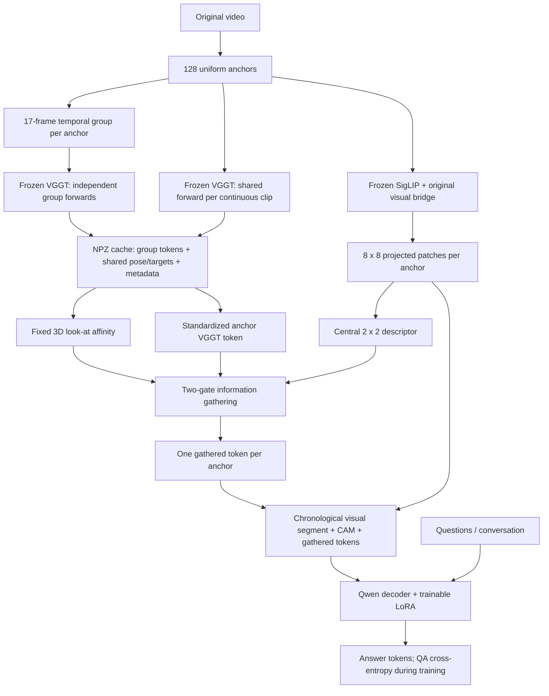

# Look-at-guided information gathering for Cambrian-P

This document describes the implemented method, the data available locally, and the experiment protocol. The inventory is a read-only snapshot taken on **2026-11-01**.

**Current status:** the implementation has passed GPU-0 smoke training, labeled evaluation, adapter reload, and generation. The full existing 10,000-QA training manifest is **not yet ready for look-at training**, because 800 of its 806 videos still need shared-coordinate geometry. The original VSI-Bench evaluation set is available and remains unchanged.

## 1. Goal and hypothesis

The original Cambrian-P hypothesis is that camera-pose supervision helps a video-language model understand space. The proposed additional hypothesis is:

> Views that look at approximately the same 3D place can exchange useful information, even when those views are far apart in time.

For example, a camera can observe a table, turn toward a doorway, and revisit the table much later. The later table view should be a possible information donor for the earlier table view; the intervening doorway view should not be selected merely because it is temporally nearby.

The implementation preserves 128 chronological anchor frames. Each anchor receives **one additional gathered token**, rather than inserting the image tokens of all its 16 temporal neighbors into the LLM. Matching uses estimated 3D optical-axis targets, not image similarity or camera-center proximity alone.

Here, "look-at" means an **approximate camera viewing target** derived from VGGT pose and depth. It is not human gaze, exact object correspondence, or a guarantee that two views see the same visible surface.

## 2. Data comparison and fixed evaluation policy

### 2.1 No new train/validation split

The experiment uses the existing manifest:

```text
/data/dataset/vggt17_feats/train_manifest/headroom_pack4_10000.jsonl
```

**All 10,000 QAs in this file remain training data.** There are 2,500 packed conversations, with four QAs per conversation, referencing 806 videos and 774 conservative scene keys.

The original evaluation is VSI-Bench's **`test` split**, which is the set called "validation" in this experiment. Do not move any of its examples into training, replace its annotations, invent a percentage-based replacement, or change its scoring.

Earlier `output/vggt17/lookat_split_6faa96cb/` files and the 9,080/920 counts in the smoke readiness report are **historical debugging artifacts**, not the current experiment definition. They are retained for traceability, not used as the proposed split. In particular, do not set `EVAL_JSON` to that derived holdout for the experiments described here.

### 2.2 What is actually available locally?

**Important correction: the raw VQA dataset is not limited to the three sources with VGGT caches.** All referenced RGB media in the released VSI-590K annotation file exist under the extracted media root:

```text
Annotations: /data/dataset/VSI-590K/vsi_590k.jsonl
RGB media:   /home/lz1bhc/datasets/VSI-590K
```

The release contains **590,667 JSONL records and 652,363 supervised QA turns**. These numbers differ because some image-based records contain multiple question/answer turns. "590K" is the dataset's rounded record count, not an exact count of supervised answers.

| Released source | Input in annotations | Records | QA turns | Referenced RGB files present |
|---|---|---:|---:|---:|
| ScanNet | Video | 92,145 | 92,145 | 1,201 |
| ScanNet++ v2 | Video | 138,701 | 138,701 | 856 |
| ARKitScenes | Video | 57,816 | 57,816 | 2,899 |
| ADT | Video | 60,207 | 60,207 | 183 |
| ProcTHOR | Video | 20,092 | 20,092 | 625 |
| S3DIS | Video | 5,187 | 5,187 | 199 |
| Hypersim | Image | 176,774 | 176,774 | 5,113 |
| Robotics | Image | 19,645 | 38,138 | 19,645 |
| YouTube room tours | Image | 20,100 | 63,303 | 20,099 |
| **Total** | Video + image | **590,667** | **652,363** | **50,820** |

The RGB files comprise 5,963 videos and 44,857 images. A video-field-only inventory would omit 216,519 records / 278,215 QA turns from Hypersim, Robotics, and YouTube room tours. Those records are **not missing data**; their media are referenced through `image`.

This is a filesystem-existence check, not a complete decoding or corruption audit. It establishes full released **VQA annotations and referenced RGB availability**, not complete availability of every auxiliary pose annotation or additional dataset used by other paper experiments.

The partial coverage is in the **precomputed feature pipeline**:

| Video source | VGGT-17 cached videos | Raw QAs covered by those caches | Videos in existing 10K manifest | QAs in existing 10K manifest |
|---|---:|---:|---:|---:|
| ScanNet | 236 | 18,958 | 213 | 3,004 |
| ScanNet++ v2 | 183 | 30,606 | 177 | 3,512 |
| ARKitScenes | 581 | 10,356 | 416 | 3,484 |
| **Total** | **1,000** | **59,920** | **806** | **10,000** |

The other six sources have no caches in the current training feature root. The three cached sources' complete local video pool contains 4,956 videos / 288,662 QAs, but only the 1,000 videos above have group caches. Image-only examples are not given a new multi-view look-at representation by this implementation.

| Coverage level | QA turns | Meaning |
|---|---:|---|
| Released annotations with local RGB | 652,363 | 100% of released QA turns |
| Videos with VGGT-17 group caches | 59,920 | 9.19% of released QA turns; potential feature-covered pool |
| Existing selected training manifest | 10,000 | 1.53% of released QA turns; actual proposed training input |
| Shared-geometry coverage inside that manifest | 104 | 26 conversations / 6 videos; 1.04% of selected QAs |

All 806 selected videos and their group caches exist. Only six currently have the additional shared-geometry arrays needed for look-at selection; **800 require scene-only backfill**. Across the entire 1,000-cache pool, the same six geometry-backed videos cover 693 raw QA turns.

Thus, there is ample raw training data and an intact evaluation set for development and experiments. The remaining blocker for the **full selected 10K look-at run is preprocessing**, not a need to create a new split.

### 2.3 How the selected training set differs from the paper

The paper's main VQA comparisons use full VSI-590K unless otherwise specified. The current pilot is a **headroom-weighted, video-only subset from three sources**, not a uniform or representative sample of all nine sources.

The selection metadata records `mix=headroom`, selection seed 0, and four-QA packing. For example, absolute object distance contributes 2,043 QAs, whereas relative object direction contributes 307. Keep this manifest fixed across method comparisons rather than regenerating or rebalancing it using evaluation results.

Packing four QAs for one video amortizes the expensive visual encoding. It also changes the conversational training context: later questions can attend to earlier answers during teacher-forced training. Counts must distinguish **2,500 training conversations** from **10,000 supervised QAs**.

| Setting | Original paper, main VQA experiment | Current implementation / pilot |
|---|---|---|
| VQA data | Full VSI-590K, nine sources | Existing 10K-QA manifest, three video sources |
| Initial model | Cambrian-S-7B stage 3 | Released local `ckpts/Cambrian-P-7B` |
| Trainable components | End-to-end vision, bridge, LLM, pose components | LLM LoRA + new VGGT projector and two gates |
| Objective | QA loss + camera-pose loss, with pose-only interleaving | QA loss only |
| Sampling | Uniform VQA sampling with jitter; separate pose sampling | Fixed 128 anchors aligned exactly with cached features |
| Extra information | Pose supervision through CAM queries | Frozen VGGT-17 context + look-at-selected view information |
| Hardware | 64 H200 GPUs | Physical GPU 0, RTX 6000 Ada |
| Global batch | 256 | Default 8 conversations: batch 1, accumulation 8 |
| Learning rates | LLM/bridge `1e-5`, vision `2e-6`, pose components `1e-4` | Default LoRA/projector `1e-4` |
| Evaluation here | Original VSI-Bench definition | Same definition, all 5,130 QAs |

The paper also describes MapAnything-based pose experiments and additional general-video training. Those are not the main VSI-only data comparison and are not reproduced here. The README's larger mixed recipe should not be confused with the paper's main VQA setting.

Because the initial checkpoint is already Cambrian-P, this is **adapter fine-tuning of a trained spatial model**, not a from-scratch reproduction of the paper. Having the full RGB release does not make the current 10K LoRA recipe equivalent to its full-data, joint-loss training.

### 2.4 Untouched VSI-Bench evaluation

The cached original annotations contain:

| Evaluation source | QAs | Videos used by annotations |
|---|---:|---:|
| ScanNet | 2,071 | 88 |
| ScanNet++ (`scannetpp`) | 1,458 | 50 |
| ARKitScenes | 1,601 | 150 |
| **Total** | **5,130** | **288** |

All 288 referenced videos exist under `/home/lz1bhc/.cache/huggingface/vsibench/`. All 288 have group caches and shared-geometry keys under `/data/dataset/vggt17_feats/vsibench/`. Key presence is not a depth-quality audit.

The extracted archive contains 512 videos; that is **not** the number of videos used by the 5,130 evaluation questions. The selected training scenes have zero overlap with the conservatively grouped benchmark archive scenes.

Keep [the original task YAML](../lmms-eval/lmms_eval/tasks/vsibench/vsibench.yaml) and [scoring utilities](../lmms-eval/lmms_eval/tasks/vsibench/utils.py) unchanged. The task's `process_docs` optionally shuffles order with seed 42; it does not filter membership, including by the annotation's `pruned` flag. Passing `all` to the evaluation launcher avoids its default 200-question limit.

## 3. End-to-end pipeline

There are two separate stages: **offline frozen-VGGT preprocessing** and **QA fine-tuning/inference**.



VGGT is **not run inside the training loop**. Its cached outputs are fixed. The graph is question-independent: different questions about the same video use the same view matching, while the LLM decides how to use the resulting tokens.

## 4. Offline preprocessing and coordinate systems

### 4.1 Anchors and 17-frame groups

For a video with `N` decoded frames, anchor indices are:

```python
anchors = np.linspace(0, N - 1, 128, dtype=int)
s = max(1, round(0.2 * fps), round((N - 1) / (127 * 17)))
```

The group for anchor `a` is ordered as:

```text
[a, a-8s, a-7s, ..., a-s, a+s, ..., a+7s, a+8s]
```

The anchor is first because VGGT uses the first frame as its reference. These are **temporally spaced neighboring frames**, not necessarily 16 immediately consecutive raw frames.

Indices are clamped to the anchor's continuous clip boundaries. `group_valid` records which positions were not clamped. Clamped duplicates are still part of the VGGT input; the validity array is metadata, not an attention mask in the current group forward.

The independent group pass produces:

| Field | Shape | Storage | Role |
|---|---|---|---|
| `group_tok` | `[128, 17, 2048]` | FP16 | Contextual VGGT camera-token features |
| `group_pose` | `[128, 17, 9]` | FP32 | Poses in each group's own reference frame |
| `group_idx` | `[128, 17]` | Integer | Decoded frame indices |
| `group_valid` | `[128, 17]` | Boolean | Unclamped input positions |

The default feature sent toward the LLM is **`group_tok[:, 0]`**, shape `[128, 2048]`. This token is contextualized by the other 16 frames in its group. Therefore, keeping only index 0 does not mean that those neighboring images had no effect; it means that their influence is compressed into the anchor's VGGT representation.

### 4.2 Why another shared-scene pass is necessary

Different 17-frame groups have different coordinate origins and potentially different scales. Their reference-camera poses cannot be compared across anchors to identify revisits.

The scene pass processes **all anchors of one continuous clip together**. With no cuts, that is one forward over all 128 anchors. With supplied cuts, each segment gets its own forward and reference frame.

| Field | Shape | Role |
|---|---|---|
| `scene_tok` | `[128, 2048]` | Optional alternative feature source |
| `scene_pose` | `[128, 9]` | Shared-coordinate pose within each clip |
| `scene_lookat` | `[128, 3]` | Estimated optical-axis target |
| `scene_depth`, `scene_conf` | `[128, h, w]` | Depth/confidence pooled over 14-by-14 pixel patches |
| `seg_id`, `seg_bounds` | Per anchor / clip boundaries | Prevent cross-cut matching |
| `scene_long_side`, `scene_hw` | Resolution metadata | Record the successful scene-pass resolution |

The default method uses **group tokens for content and scene geometry for matching**. `scene_tok` is stored but not used by that default. Switching to scene tokens changes the input distribution and should use corresponding training normalization and training, not be treated as an interchangeable inference override.

VGGT images are resized without square padding or cropping, with both dimensions multiples of 14. Group passes use long side 518. Scene passes default to 518, retrying at 448 on CUDA OOM. The verified smoke backfills used 448.

`--scene_only` adds the missing scene arrays to existing caches. It preserves group features, uses cached cut boundaries when no new cuts are supplied, checks sampling alignment, and replaces each cache atomically through a temporary file. It does not require changing annotations or selecting a new split.

## 5. Defining what the camera looks at

Let the estimated world-to-camera transform for anchor `i` be `(R_i, t_i)`. Its camera center and world-space forward direction are:

$$
c_i = -R_i^\top t_i,\qquad f_i = R_i^\top [0,0,1]^\top.
$$

In code, `f_i` is the third row of `R_i`. Let `d_i` be the median VGGT depth in the central 20% crop of the unpadded image. The target is:

$$
p_i = c_i + d_i f_i.
$$

The loader converts the stored pose encoding back to extrinsics and recovers ray depth as:

$$
d_i = (p_i-c_i)^\top f_i.
$$

An anchor is eligible for nonself matching only when its pose and target are finite, its quaternion norm exceeds `1e-6`, its ray depth is finite and positive, and its segment ID is nonnegative.

This differs from selecting nearby camera centers: cameras can be far apart and look at the same place, or be near each other and face different places. Two opposite viewpoints can match if their estimated targets coincide.

## 6. Fixed view-affinity graph

For each continuous clip `s`, compute the median positive ray depth over valid anchors:

$$
D_s = \operatorname{median}_{i\in s,\ \mathrm{valid}(i)} d_i.
$$

For distinct anchors `i` and `j`, a donor is allowed when:

1. Both geometries are valid and belong to the same clip.
2. Their decoded frame indices differ, avoiding duplicate-anchor donors in short videos.
3. Their target distance satisfies `||p_i-p_j|| <= r D_s`.
4. Their anchor-position gap satisfies the selected temporal scope.

The default radius is `r=0.15`. Allowed raw weights are:

$$
u_{ij} = \exp\left[-\frac{1}{2}
\left(\frac{\lVert p_i-p_j\rVert_2}{rD_s}\right)^2\right].
$$

Disallowed weights are zero. Self weight is forced to one, even for invalid geometry. Normalize each row:

$$
W_{ij} = \frac{u_{ij}}{\sum_k u_{ik}}.
$$

| Scope | Allowed nonself temporal gaps |
|---|---|
| `all` | Any gap; supports both local views and distant revisits |
| `near` | Less than `FAR_GAP`, default 32 |
| `far` | At least `FAR_GAP`, default 32 |
| `self` | None; token-budget-matched no-gathering control |

The gap is measured in **positions among the 128 anchors**, not seconds or raw-frame indices. Nearby anchors still need spatial agreement; distant anchors are not selected merely for being far away.

There is no learned retrieval network, appearance scoring, top-K selection, or trainable graph attention. All geometrically eligible donors receive weights. Confidence maps are stored but are not currently used to filter or weight the graph.

Using `D_s` makes matching invariant to a shared rigid transform and uniform scale change within a clip. This does not make independently reconstructed groups comparable: matching still requires the shared scene reconstruction.

## 7. Network architecture and fusion equations

### 7.1 Existing visual and language backbone

The local checkpoint and launcher configure:

| Component | Architecture / dimensions | Training status |
|---|---|---|
| RGB preprocessing | Square padding, then 384-by-384 input | Fixed |
| Vision tower | `google/siglip-so400m-patch14-384`, selected layer `-2` | Frozen |
| Vision patches | 27-by-27 = 729 patches, dimension 1152 | Fixed backbone output |
| Original visual bridge | Linear `1152 -> 3584`, GELU, Linear `3584 -> 3584` | Frozen |
| Spatial reduction | Bilinear 27-by-27 to 8-by-8 | Fixed |
| Language decoder | Qwen2-style implementation; hidden size 3584, 28 layers | Base frozen, LoRA trained |
| Decoder attention | 28 query heads, 4 KV heads | LoRA on decoder projections |
| Decoder MLP | Intermediate size 18,944 | LoRA on gate/up/down projections |
| Vocabulary / context | 151,672 / 32,768 positions | Inherited |
| Original CAM/pose modules | Two CAM templates, 2048-dimensional pose path, depth-four camera trunk | Frozen |

The paper describes SigLIP2-SO400m and Qwen2.5. The local configured vision identifier above is **SigLIP**, not an identifier for SigLIP2; this document follows the actual checkpoint and launcher rather than silently relabeling it.

For video inputs, `mm_img_tok_num=64` selects an 8-by-8 target grid. The bilinear branch takes the square root of this token-count argument; its final grid is not determined by simply dividing 27 by the configured stride 2.

### 7.2 Central visual-content descriptor

From the existing per-frame image segment, remove CAM and row-newline tokens, recovering `[128, 8, 8, 3584]`. Pool the central grid region:

```python
lo = int(0.4 * 8)       # 3
hi = math.ceil(0.6 * 8) # 5
v = grid[:, lo:hi, lo:hi].mean(dim=(1, 2))
```

Thus `v_i` has dimension 3584 and summarizes a central **2-by-2** patch region. This is a coarse, quantized center descriptor, not exactly the pixel crop used for VGGT depth. Square padding and different preprocessing also prevent pixel-exact equivalence between the two branches.

The descriptor uses already-computed anchor patches. It adds no separate vision encoder and does not independently encode the 16 neighboring frames with SigLIP.

### 7.3 Contextual VGGT gathering

Let `g_i` be the 2048-dimensional contextual anchor token. Standardize it using fixed training-only buffers:

$$
x_i = (g_i-\mu)/\sigma.
$$

Define `A` as the row-normalized `W` with its diagonal removed, **without renormalizing again**, and let:

$$
m_i = \sum_{j\ne i} A_{ij}.
$$

The first learned gate is a global scalar:

$$
\alpha=\operatorname{sigmoid}(a),\qquad
x'_i=x_i+\alpha\left(\sum_{j\ne i}A_{ij}x_j-m_i x_i\right).
$$

This is a bounded move toward matching neighbors' VGGT context. Effective mixing is `alpha * m_i`, not an unconditional 10% replacement.

Project into the LLM embedding space:

$$
h_i = \operatorname{Linear}_{3584\to3584}
\left(\operatorname{GELU}
\left(\operatorname{Linear}_{2048\to3584}(x'_i)\right)\right).
$$

### 7.4 Visual-content gathering

A second independent global gate adds the matching views' central visual-content difference:

$$
\beta=\operatorname{sigmoid}(b),\qquad
z_i=h_i+\beta\left(\sum_{j\ne i}A_{ij}v_j-m_i v_i\right).
$$

`z_i` is the **single additional token** for anchor `i`, dimension 3584.

The first branch gathers contextual VGGT features; the second exposes differences in actual projected visual content. Using a delta avoids adding the anchor's own visual descriptor again when it already has its ordinary image patches.

Both gates initialize to 0.1, with logits `log(0.1/0.9)`. They are learned globally, not separately for each anchor, question, or edge.

When there are no valid nonself donors, `A` and `m_i` are zero:

```text
x'_i = x_i
z_i  = MLP(x_i)
```

This exactly recovers the anchor-only VGGT-token path. The implementation removes diagonal terms explicitly instead of calculating `W @ x - x`; CUDA TF32 can otherwise make an identity matrix multiplication differ numerically from its input.

### 7.5 Shapes and trainable parameters

```text
Cached group token:       [128, 17, 2048]
Anchor token selection:   [128, 2048]
Shared targets / depths:  [128, 3] / [128]
Affinity W / offdiag A:   [128, 128]
Central visual content:  [128, 3584]
Gathered VGGT context:    [128, 2048]
New projector output:    [128, 3584]
Final extra tokens z:     [128, 3584]
```

The new projector is Linear `2048 -> 3584`, GELU, Linear `3584 -> 3584`, plus two gates: **20,192,258 trainable parameters**, including biases. Its mean/std buffers are saved but not trained.

LoRA uses rank 64, alpha 128, and dropout 0.05 on seven decoder linears per layer: `q_proj`, `k_proj`, `v_proj`, `o_proj`, `gate_proj`, `up_proj`, and `down_proj`. Across 28 layers, that is **196 target modules / 161,480,704 LoRA parameters**. Total trainable parameters are approximately **181.67 million**.

## 8. Token budget and original CAM compatibility

With the current grid-newline and append-to-frame configuration, each anchor contributes:

```text
8 rows of (8 projected image patches + 1 row newline)
1 original CAM token
1 new gathered token
```

| Configuration | Tokens per anchor | Visual/CAM/gather segment for 128 anchors |
|---|---:|---:|
| Local original CAM-only baseline | 64 + 8 + 1 = 73 | 9,344 |
| VGGT-17 anchor-only token baseline | 64 + 8 + 1 + 1 = 74 | 9,472 |
| Look-at `self`, `near`, `far`, or `all` | 74 | 9,472 |

These counts exclude prompt, question, and answer tokens. The new method adds only **128 LLM tokens**, not 128-by-17 frame representations. Naively representing all 2,176 image slots with the same 73-token layout would require 158,848 visual/CAM tokens, already beyond the configured context window.

Anchor order and existing patches remain unchanged. The added token does not replace a patch or CAM query. The first anchor uses original CAM template 0; remaining anchors use template 1. The two templates are not two tokens inserted into every frame.

The gathered token is recorded as `vggt_token_count=1`. Reconstruction slicing removes it before extracting original CAM/patch features, preventing a shifted token layout. All visual, newline, CAM, and gathered positions have `IGNORE_INDEX` labels.

The current launchers retain CAM tokens during both training and evaluation. The paper describes its extra pose tokens as training-time additions; therefore, this local inference protocol should not be presented as an exact reproduction of that claim. Use identical CAM settings for the local matched controls.

This method is **offline full-video gathering**: a later revisit can contribute to an earlier anchor's token. Chronological token order does not make that operation streaming-causal.

## 9. Training objective, precision, and persistence

The new training path optimizes answer-token cross-entropy only. It does not add look-at labels, train VGGT, supervise its cached poses, or introduce a new pose loss. The original pose modules remain present for compatibility but are frozen.

`lm_loss_labels_only=True` computes vocabulary logits only at supervised shifted-label positions during labeled training/evaluation. It preserves the masked mean cross-entropy and gradients while avoiding full-vocabulary logits for thousands of ignored visual positions. Generation uses the normal unlabeled path.

The launcher uses BF16, FlashAttention2, gradient checkpointing, vision chunks of 32 frames, batch 1, accumulation 8, cosine learning-rate scheduling, and an optional CUDA allocator cap, default 32 GiB. It uses plain single-GPU/DDP execution rather than a DeepSpeed path that would cast the intended FP32 projector parameters.

Standardization, geometric weights, and gated deltas are computed in FP32. Projector parameters and normalization buffers stay FP32; the MLP can execute under BF16 autocast. The final added token is cast to the image/LLM embedding dtype. Projector gradients are clipped separately so their norm does not determine the LoRA clipping factor.

The new MLP weights initialize with standard deviation 0.02 and zero biases, rather than an all-zero output token. Near-zero embeddings interact badly with the LLM's input RMS normalization and were unstable in initial testing.

### 9.1 Normalization

Compute mean/std from the **806 unique videos in the original 10K training manifest**, counting each video's 128 anchor tokens once: 103,168 tokens. Statistics are video-uniform, not weighted by how many conversations reuse each video. Standard deviations are floored at `1e-4` when loaded.

Do not include VSI-Bench caches in these statistics. Do not reuse the historical 726-video split statistics as the intended normalization for the full 10K experiment. All matched gathering runs should use the same training-only statistics.

### 9.2 Saving and loading

PEFT `modules_to_save=vggt_projector` saves the complete new MLP, both gates, and normalization buffers together with LoRA A/B matrices. Gathering configuration is saved in the model config.

The gates use length-one parameters rather than zero-dimensional tensors. This preserves scalar mathematics while avoiding a missing-parameter allocation failure in the installed Transformers low-memory loader.

During evaluation, the wrapper reconstructs the projector from saved configuration, restores its state, loads geometry on the evaluation device, and merges LoRA into the base model. An adapter's gather mode cannot be changed explicitly to a structurally different mode; use `scope=self` for a no-gathering ablation.

The loader/preflight validates required cache keys and anchor alignment. Runtime loading additionally checks decoded frame count/duration, feature shape/finiteness, and geometry shapes. Incompatible VGGT features propagate as `VGGTFeatureError` rather than silently substituting another training example. Invalid per-anchor geometry instead produces the defined self-only fallback.

## 10. Commands for the full existing 10K experiment

These commands are the next-run recipe, **not jobs launched while writing this document**. Run from the repository root and use the existing `cambrianp` mamba environment. GPU arguments are always physical GPU 0.

### 10.1 List the original manifest's training videos

This creates a video list for preprocessing, not a new annotation manifest or train/validation split:

```bash
CUDA_VISIBLE_DEVICES= mamba run -n cambrianp python - <<'PY'
import json
from pathlib import Path

manifest = Path("/data/dataset/vggt17_feats/train_manifest/headroom_pack4_10000.jsonl")
with manifest.open() as f:
    videos = sorted({json.loads(line)["video"] for line in f if line.strip()})
out = Path("output/vggt17/lookat_10k_train_videos.txt")
out.parent.mkdir(parents=True, exist_ok=True)
out.write_text("\n".join(videos) + "\n")
print(len(videos), "training videos; original manifest unchanged")
PY
```

### 10.2 Backfill training geometry only

```bash
CUDA_VISIBLE_DEVICES=0 PYTHONPATH="$PWD" \
  mamba run -n cambrianp python scripts/vggt17/precompute_vggt.py \
  --root /home/lz1bhc/datasets/VSI-590K \
  --video_list output/vggt17/lookat_10k_train_videos.txt \
  --out /data/dataset/vggt17_feats/train \
  --scene_only --long_sides 448
```

Already geometry-complete caches are skipped; 800 selected videos remain at this snapshot. The 448-pixel scene pass matches the tested backfills. This operation updates **training caches only**, preserving group features; it does not touch VSI-Bench annotations or caches. It can be a long job and requires GPU-0 headroom. Unlike the training launcher, this precompute command has no explicit allocator-cap option.

### 10.3 Compute full-manifest training statistics

```bash
CUDA_VISIBLE_DEVICES= PYTHONPATH="$PWD" \
  mamba run -n cambrianp python scripts/vggt17/feature_stats.py \
  --feat_dir /data/dataset/vggt17_feats/train \
  --source group \
  --jsonl /data/dataset/vggt17_feats/train_manifest/headroom_pack4_10000.jsonl \
  --out output/vggt17/stats_10k_train_group.npz
```

### 10.4 Train without inventing a validation split

```bash
env -u EVAL_JSON \
  VGGT=1 GATHER_MODE=lookat GATHER_SCOPE=all GATHER_RADIUS=0.15 FAR_GAP=32 \
  VGGT_DIR=/data/dataset/vggt17_feats/train \
  VGGT_STATS=output/vggt17/stats_10k_train_group.npz \
  DATA_PATH=/home/lz1bhc/datasets/VSI-590K CKPT=ckpts/Cambrian-P-7B \
  LR=1e-4 PROJ_LR=1e-4 EPOCHS=1 MAX_STEPS=-1 BS=1 GRAD_ACC=8 MEM_CAP_GB=32 \
  OMP_NUM_THREADS=2 MKL_NUM_THREADS=2 OPENBLAS_NUM_THREADS=2 \
  mamba run -n cambrianp bash scripts/vggt17/run_train.sh \
  0 /data/dataset/vggt17_feats/train_manifest/headroom_pack4_10000.jsonl \
  output/vggt17/lookat_10k_all
```

Use distinct output directories for independent experiments; the launcher resumes the last complete checkpoint in an existing directory. The full manifest should fail preflight until missing geometry is supplied, rather than silently reducing the training set.

### 10.5 Evaluate the complete original benchmark

```bash
env -u VGGT_STATS \
  HF_HOME=/home/lz1bhc/.cache/huggingface \
  VGGT_DIR=/data/dataset/vggt17_feats/vsibench \
  LORA=output/vggt17/lookat_10k_all GATHER_SCOPE=all \
  OMP_NUM_THREADS=2 MKL_NUM_THREADS=2 OPENBLAS_NUM_THREADS=2 \
  mamba run -n cambrianp bash scripts/vggt17/run_eval.sh \
  0 29611 lookat_10k_all_vsibench all
```

The final `all` is essential. Use a fresh result tag/directory and verify that the result/sample logs cover all 5,130 QAs without errors; an evaluator's zero exit code alone is not sufficient evidence of successful evaluation. Use saved training normalization, not statistics recomputed from evaluation videos.

## 11. Comparisons needed to test the hypothesis

Keep training data, packing, base checkpoint, CAM layout, statistics, optimizer schedule, and evaluation protocol fixed.

| Control / method | Training options | What it tests |
|---|---|---|
| CAM-only LoRA baseline | `VGGT=0 GATHER_MODE=none` | Effect of adding the frozen-VGGT branch at all |
| Anchor-only VGGT-17 | `VGGT=1 GATHER_MODE=none` | Context compressed from the 17-frame neighborhood, no cross-anchor gathering |
| Matched self control | `VGGT=1 GATHER_MODE=lookat GATHER_SCOPE=self` | Same token budget and module layout, no nonself donors |
| Near look-at | `... GATHER_SCOPE=near` | Spatial matching among nearby anchors |
| Far look-at | `... GATHER_SCOPE=far` | Spatial matching across distant revisits |
| Full look-at | `... GATHER_SCOPE=all` | Combining near and far matching |

All VGGT variants have 9,472 visual-segment tokens. `self` still includes the original 17-frame contextual group token; it does not remove temporal context already present in that frozen feature.

Independent training runs with matched settings provide the primary comparison. Overriding `GATHER_SCOPE` on one saved adapter is also implemented, but is an **inference intervention**, not an equivalent replacement for separately trained controls.

To support the revisit claim, report the full benchmark and its task breakdown, compare far/all against the matched self/near controls, and include `neighbors` / `far_neighbors` diagnostics. A nonzero far-neighbor count verifies execution of the mechanism, not an accuracy gain or causal use of those donors.

No conclusion about improvement is justified until those evaluations are complete. Repeated tuning against this formal test set also weakens a clean final-test claim, even when the files themselves remain untouched.

## 12. Completed verification and remaining limitations

The corrected smoke artifact is:

```text
output/vggt17/lookat_gpu0_6faa96cb_v2/
```

| Check | Observed result |
|---|---|
| CPU regressions | 9 cases passed |
| CUDA precision regression | Exact self/invalid fallback under TF32 passed |
| Full-128-anchor training on GPU 0 | Three steps; losses 0.2812, 0.1120, 0.1088 |
| Smoke labeled evaluation | Loss 0.009581997 on one conversation / four QAs |
| Parameter updates | Both gates and all 196 LoRA-B matrices updated |
| Saved state | All 400 tensors finite |
| Adapter reload | Projector/statistics recovered exactly; LoRA merge checked |
| Actual generation | Produced `B` on a smoke evaluation video; near/far gathering active |
| Peak allocated memory | 24.64 GiB training; 26.45 GiB reload/inference |

These checks establish that training, persistence, and generation work. They are **not full-10K training or official VSI-Bench accuracy results**. The earlier zero-dimensional-gate artifact without the `_v2` suffix is superseded. The corrected smoke model also used historical debugging normalization/samples; it is not the final full-manifest experiment.

Remaining limitations:

1. **Geometry coverage:** 800 selected training videos still need shared-scene preprocessing.
2. **Approximate matching:** one central-depth optical-axis point cannot establish full-frustum overlap, occlusion, object identity, or correct correspondence in a dynamic scene.
3. **Geometry quality:** VGGT errors can select incorrect donors; confidence maps are not used yet.
4. **Coarse content pooling:** central 2-by-2 anchor features may miss off-center objects, and the RGB/VGGT crops are not pixel-identical.
5. **Temporal coverage:** the LLM still receives only 128 anchor images. The neighboring frames influence VGGT context, but their SigLIP patches are not independently gathered. Unsampled events can still be missed.
6. **Offline assumption:** future frames can inform earlier tokens; this is not a streaming method.
7. **Experiment scope:** the 10K subset, LoRA-only optimization, and trained Cambrian-P initialization differ materially from the paper's full-data end-to-end recipe.

## 13. Implementation map and references

| File | Responsibility |
|---|---|
| [VGGT projector and feature loader](../cambrianp/model/multimodal_projector/vggt_token.py) | Cache validation, shared geometry, affinities, normalization, two-gate fusion |
| [Multimodal architecture](../cambrianp/model/llava_arch.py) | Vision pooling, central descriptors, per-anchor gathered-token insertion |
| [VGGT reconstructor](../cambrianp/model/reconstructor/vggt_reconstructor.py) | First/rest CAM templates and gathered-token exclusion during reconstruction |
| [Training entry point](../cambrianp/train/train.py) | Feature preflight, data/collation, LoRA/freeze policy, projector initialization and saving |
| [Qwen wrapper](../cambrianp/model/language_model/llava_qwen.py) | Geometry propagation, sparse supervised-position CE, generation integration |
| [Evaluation model](../lmms-eval/lmms_eval/models/simple/cambrian_p.py) | Saved gathering configuration, adapter loading and evaluation feature bundles |
| [Precompute](../scripts/vggt17/precompute_vggt.py) | Temporal groups, shared-scene teacher pass, atomic scene-only backfill |
| [Feature statistics](../scripts/vggt17/feature_stats.py) | Exact training-manifest mean/std |
| [Training launcher](../scripts/vggt17/run_train.sh) | GPU selection and matched LoRA recipes |
| [Evaluation launcher](../scripts/vggt17/run_eval.sh) | Original benchmark evaluation and scope interventions |
| [Regression tests](../scripts/vggt17/test_lookat.py) | Geometry, fallback, gradients, visual gathering and low-memory loading |
| [Round-trip test](../scripts/vggt17/test_lora_roundtrip.py) | Adapter/state recovery, LoRA merging and real generation |

Original paper: [Cambrian-P: Pose-Grounded Video Understanding](https://arxiv.org/html/2605.22819v1), especially Sections 3 and 4.1. Dataset reference: [VSI-590K](https://huggingface.co/datasets/nyu-visionx/VSI-590K). Evaluation reference: [VSI-Bench](https://huggingface.co/datasets/nyu-visionx/VSI-Bench).

For reproducibility, the unchanged selected training manifest SHA-256 is:

```text
a98f2b09b033f531c41b3ffa95f1d4020eb912282b6e704881037ccad6465727
```
